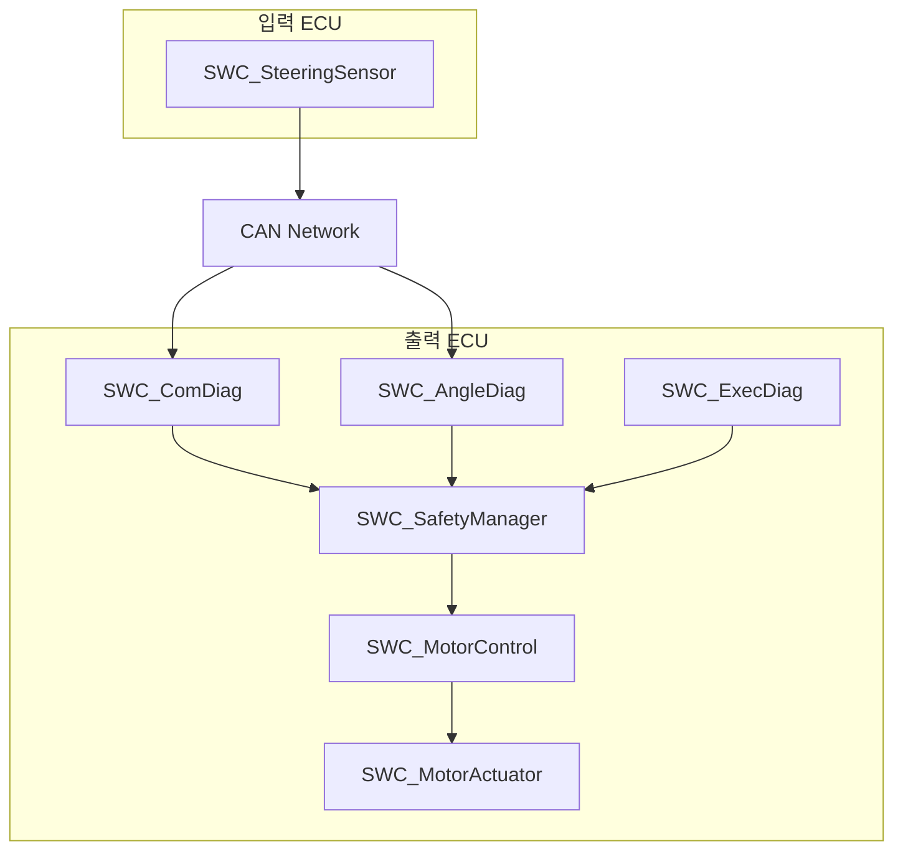
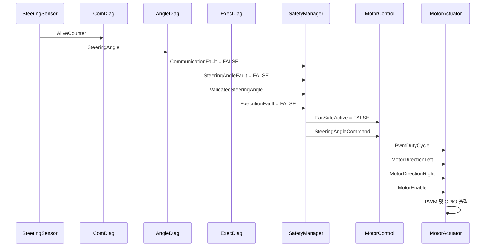
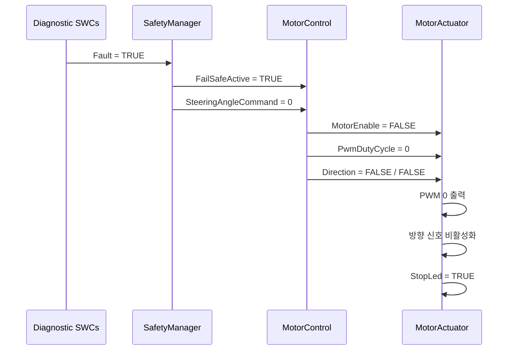

# 소프트웨어 아키텍처 설계 명세서 (Software Architecture Design Specification)

**Document ID**: STEER-04-SWADS  
**ISO 26262 Reference**: Part 6, Clause 7  
**ASPICE Reference**: SWE.2  
**Version**: 1.6 (개정안)  
**Date**: 2026-10-24  
**Status**: Draft — 현행 src/ 기준 구조 정합화  
**Project Title**: AUTOSAR 기반 조향 관련 오류에 대한 복구 및 진단 시스템

---

## 1. 문서 목적

본 문서는 소프트웨어 요구사항을 SWC에 할당하고, 입력 ECU와 출력 ECU의 소프트웨어 아키텍처를 정의한다.

기존 5개 SWC 구조를 현재 src/의 7개 SWC 구조에 맞춰 개정하였으며, 각 SWC의 책임, Interface, Port, Runnable, 데이터 흐름 및 요구사항 추적 관계를 명시한다.

본 문서는 소프트웨어 아키텍처 설계에 초점을 맞추며, 구체적인 알고리즘과 구현 내용은 상세설계 문서에서 관리한다.

## 2. 아키텍처 설계 원칙

| 설계 원칙 | 적용 내용 |
|---|---|
| 기능 분리 | 통신, 조향각, 실행 진단을 독립 SWC로 분리 |
| 낮은 결합도 | AUTOSAR Port 및 Interface를 통해 SWC 간 데이터 교환 |
| 높은 응집도 | 각 SWC가 하나의 주요 책임을 수행 |
| 안전 판단 집중 | SafetyManager가 진단 결과를 통합하여 안전 명령 결정 |
| Fail-Safe 우선 | 오류 발생 시 정상 제어보다 모터 출력 차단 우선 |
| 하드웨어 추상화 | IoHwAb를 통해 하드웨어 의존성 분리 |
| 재사용성 | 인터페이스를 유지하면서 개별 SWC 변경 가능 |
| 추적성 | 요구사항과 SWC, Interface, Runnable 연결 |

## 3. 전체 소프트웨어 아키텍처

### 3.1 ECU 구성

본 시스템은 CAN 통신으로 연결된 두 개의 ECU로 구성된다.

- 입력 ECU: 조향 입력값을 읽고 CAN 통신으로 전달
- 출력 ECU: 수신 데이터 진단, 안전 상태 판단, 모터 제어 및 출력

### 3.2 SWC 구성도

### 3.3 SWC 목록

| SWC ID | SWC 이름 | ECU | 주요 역할 |
|---|---|---|---|
| SWC-001 | SWC_SteeringSensor | 입력 ECU | 조향각 및 Alive Counter 생성 |
| SWC-002 | SWC_ComDiag | 출력 ECU | 통신 이상 진단 및 복구 판단 |
| SWC-003 | SWC_AngleDiag | 출력 ECU | 조향각 유효성 진단 |
| SWC-004 | SWC_ExecDiag | 출력 ECU | SW 실행 이상 진단 |
| SWC-005 | SWC_SafetyManager | 출력 ECU | Fault 통합 및 Fail-Safe 판단 |
| SWC-006 | SWC_MotorControl | 출력 ECU | PWM 및 모터 방향 계산 |
| SWC-007 | SWC_MotorActuator | 출력 ECU | 실제 모터 출력 제어 |

## 4. SWC별 상세 책임

### 4.1 SWC_SteeringSensor

**역할**

가변저항을 통해 조향 입력값을 읽고, 조향각과 Alive Counter를 생성하여 출력 ECU로 전달한다.

**입력**

- IoHwAb ADC 입력값

**처리**

- ADC 입력값 읽기
- ADC 중앙값 512를 기준으로 조향각 변환
- Alive Counter 증가

**출력**

- AliveCounter: uint8
- SteeringAngle: sint16

**Runnable**

- RE_Can_Tx_10ms

**실행 주기**

- 10 ms

### 4.2 SWC_ComDiag

**역할**

Alive Counter를 이용하여 CAN 통신 데이터의 연속성을 검사하고, 통신 이상 및 정상 복귀 여부를 판단한다.

**입력**

- AliveCounter

**처리**

- Alive Counter +1 증가 여부 검사
- 255에서 0으로 순환하는 Wrap-around 처리
- 연속 오류 2회 발생 시 통신 Fault 판단
- Fail-Safe 이후 첫 정상 수신값을 기준값으로 설정
- 이후 +1 증가 3회 연속 확인 시 통신 Fault 해제

**출력**

- CommunicationFault: boolean

**상태**

- ALIVE_STATE_INIT
- ALIVE_STATE_NORMAL
- ALIVE_STATE_RECOVERY_FIRST
- ALIVE_STATE_RECOVERY_CHECK

**설계 유의사항**

Alive Counter의 시퀀스 검사와 CAN 메시지 Timeout 진단은 구분해야 한다.

실제 통신 중단 시 Fault를 검출할 수 있도록 CAN 수신 갱신 여부와 Timeout 설정을 확인해야 한다.

### 4.3 SWC_AngleDiag

**역할**

수신한 조향각의 유효성을 검사하고 정상 조향각을 전달한다.

**입력**

- SteeringAngle

**처리**

- RTE Read 성공 여부 검사
- 조향각 유효 범위 검사
- 정상 범위: -512 ~ 511
- 비정상 데이터 발생 시 Fault 출력

**출력**

- SteeringAngleFault: boolean
- ValidatedSteeringAngle: sint16

**안전 처리**

조향각이 유효하지 않으면 SteeringAngleFault를 TRUE로 설정하고 ValidatedSteeringAngle은 0으로 출력한다.

### 4.4 SWC_ExecDiag

**역할**

Watchdog Manager를 이용하여 SW 실행 이상을 진단한다.

**입력**

- WdgM Global Status

**처리**

- WdgM 상태 조회
- WDGM_GLOBAL_STATUS_FAILED 검사
- WDGM_GLOBAL_STATUS_EXPIRED 검사
- WDGM_GLOBAL_STATUS_STOPPED 검사
- WdgM 서비스 호출 실패 검사

**출력**

- ExecutionFault: boolean

**설계 유의사항**

WdgM이 실제로 감시할 Runnable, Supervised Entity, Checkpoint 및 오류 반응 정책은 ECU Configuration에서 정의해야 한다.

### 4.5 SWC_SafetyManager

**역할**

각 진단 SWC에서 전달받은 Fault를 통합하여 시스템의 안전 상태를 판단하고, 안전한 조향 명령을 생성한다.

**입력**

- CommunicationFault
- SteeringAngleFault
- ExecutionFault
- ValidatedSteeringAngle

**처리**

1. 통신 진단 결과 확인
2. 조향각 진단 결과 확인
3. 실행 진단 결과 확인
4. RTE Read 성공 여부 확인
5. NORMAL 또는 FAIL-SAFE 상태 판단
6. 안전 상태에 따른 조향 명령 결정

**NORMAL 조건**

- CommunicationFault = FALSE
- SteeringAngleFault = FALSE
- ExecutionFault = FALSE
- 모든 RTE Read 성공

**NORMAL 출력**

- FailSafeActive = FALSE
- SteeringAngleCommand = ValidatedSteeringAngle

**FAIL-SAFE 조건**

- 하나 이상의 Fault 발생
- 하나 이상의 RTE Read 실패

**FAIL-SAFE 출력**

- FailSafeActive = TRUE
- SteeringAngleCommand = 0

**출력**

- FailSafeActive: boolean
- SteeringAngleCommand: sint16

**추가 기능**

- WdgM CheckpointReached 호출

SafetyManager는 통신 복구 횟수를 직접 관리하지 않는다.

통신 복구 판단은 ComDiag에서 수행하며, SafetyManager는 전달된 Fault 상태를 통합하여 최종 안전 명령을 결정한다.

### 4.6 SWC_MotorControl

**역할**

SafetyManager의 조향 명령과 Fail-Safe 상태를 기반으로 모터의 PWM Duty 및 회전 방향을 계산한다.

**입력**

- SteeringAngleCommand
- FailSafeActive

**처리**

- RTE Read 성공 여부 검사
- Fail-Safe 상태 확인
- 이전 조향각과 현재 조향각의 차이 계산
- 조향각 변화 방향 판단
- 조향각 변화량에 따른 PWM Duty 계산
- 정상 복귀 시 기준 조향각 재설정

**출력**

- PwmDutyCycle: uint16
- MotorDirectionLeft: boolean
- MotorDirectionRight: boolean
- MotorEnable: boolean

**FAIL-SAFE 처리**

- PwmDutyCycle = 0
- MotorDirectionLeft = FALSE
- MotorDirectionRight = FALSE
- MotorEnable = FALSE

**정상 복귀 처리**

Fail-Safe 해제 후 첫 정상 조향각은 이전 조향각의 기준값으로 저장한다.

해당 실행 주기에는 모터를 구동하지 않고 다음 정상 입력부터 조향각 변화량을 계산한다.

**PWM 범위**

- PWM Duty 최대값: 16384
- PWM 표현 기준: 32768
- 최대 출력 비율: 50%

### 4.7 SWC_MotorActuator

**역할**

MotorControl에서 계산한 PWM 및 방향 명령을 실제 하드웨어 출력으로 변환한다.

**입력**

- PwmDutyCycle
- MotorDirectionLeft
- MotorDirectionRight
- MotorEnable

**처리**

- RTE Read 성공 여부 검사
- PWM Duty 유효성 검사
- 모터 방향 명령 유효성 검사
- MotorEnable 상태 확인
- IoHwAb를 통한 PWM 및 GPIO 출력

**NORMAL 동작**

- MotorEnable = TRUE
- 유효한 PWM 및 방향 명령을 모터 드라이버에 전달
- StopLed = FALSE

**FAIL-SAFE 동작**

- PWM Duty = 0
- MotorIn1 = FALSE
- MotorIn2 = FALSE
- StopLed = TRUE

**설계 유의사항**

실제 모터 회전 방향은 MotorIn1, MotorIn2의 하드웨어 연결에 따라 결정된다.

출력 서비스 실패 시 안전 차단을 보장하기 위한 별도 대응 및 검증이 필요하다.

## 5. AUTOSAR Interface 설계

### 5.1 Sender-Receiver Interface

| Interface ID | Interface 이름 | Data Element | 데이터 타입 |
|---|---|---|---|
| IF-001 | If_SteeringSensorData | AliveCounter | uint8 |
| IF-001 | If_SteeringSensorData | SteeringAngle | sint16 |
| IF-002 | If_CommunicationDiagnostic | CommunicationFault | boolean |
| IF-003 | If_SteeringAngleDiagnostic | SteeringAngleFault | boolean |
| IF-003 | If_SteeringAngleDiagnostic | ValidatedSteeringAngle | sint16 |
| IF-004 | If_ExecutionDiagnostic | ExecutionFault | boolean |
| IF-005 | If_SafeSteeringCommand | SteeringAngleCommand | sint16 |
| IF-005 | If_SafeSteeringCommand | FailSafeActive | boolean |
| IF-006 | If_MotorDriveCommand | PwmDutyCycle | uint16 |
| IF-006 | If_MotorDriveCommand | MotorDirectionLeft | boolean |
| IF-006 | If_MotorDriveCommand | MotorDirectionRight | boolean |
| IF-006 | If_MotorDriveCommand | MotorEnable | boolean |

### 5.2 Port 설계

| SWC | Port | 방향 | Interface |
|---|---|---|---|
| SteeringSensor | P_SteeringSensorData | P-Port | If_SteeringSensorData |
| ComDiag | R_SteeringSensorData | R-Port | If_SteeringSensorData |
| ComDiag | P_CommunicationDiagnostic | P-Port | If_CommunicationDiagnostic |
| AngleDiag | R_SteeringSensorData | R-Port | If_SteeringSensorData |
| AngleDiag | P_SteeringAngleDiagnostic | P-Port | If_SteeringAngleDiagnostic |
| ExecDiag | P_ExecutionDiagnostic | P-Port | If_ExecutionDiagnostic |
| SafetyManager | R_CommunicationDiagnostic | R-Port | If_CommunicationDiagnostic |
| SafetyManager | R_SteeringAngleDiagnostic | R-Port | If_SteeringAngleDiagnostic |
| SafetyManager | R_ExecutionDiagnostic | R-Port | If_ExecutionDiagnostic |
| SafetyManager | P_SafeSteeringCommand | P-Port | If_SafeSteeringCommand |
| MotorControl | R_SafeSteeringCommand | R-Port | If_SafeSteeringCommand |
| MotorControl | P_MotorDriveCommand | P-Port | If_MotorDriveCommand |
| MotorActuator | R_MotorDriveCommand | R-Port | If_MotorDriveCommand |

### 5.3 Client-Server Interface

| 사용 SWC | 서비스 Port | 목적 |
|---|---|---|
| SteeringSensor | R_Potentiometer | ADC 입력 |
| ExecDiag | R_WdgMService | WdgM 상태 조회 |
| SafetyManager | R_SafetyWdgMCheckpoint | Checkpoint 보고 |
| MotorActuator | R_PwmMotor | PWM Duty 출력 |
| MotorActuator | R_MotorIn1 | 모터 방향 출력 |
| MotorActuator | R_MotorIn2 | 모터 방향 출력 |
| MotorActuator | R_StopLed | Fail-Safe 표시 |

Client-Server 서비스의 Operation 및 실제 RTE API는 생성된 RTE 설정과 일치해야 한다.

## 6. Runnable 및 Event 설계

| Runnable ID | SWC | Runnable | 실행 조건 |
|---|---|---|---|
| RUN-001 | SteeringSensor | RE_Can_Tx_10ms | 10 ms Timing Event |
| RUN-002 | ComDiag | ComDiag_func | 신규 Alive Counter 수신 기반 |
| RUN-003 | AngleDiag | AngleDiag_func | 조향각 수신 기반 |
| RUN-004 | ExecDiag | ExecDiag_func | 주기 실행 |
| RUN-005 | SafetyManager | SafetyManager_func | 진단 결과 통합 실행 |
| RUN-006 | MotorControl | MotorControl_func | 안전 조향 명령 처리 |
| RUN-007 | MotorActuator | MotorActuator_func | 모터 구동 명령 처리 |

위 실행 조건은 아키텍처 설계 기준이며 실제 Timing Event, Data Received Event 및 Task Mapping은 ARXML 설정에서 확정한다.

통신 중단 시에도 Fault 판단과 모터 차단이 실행되도록 Timeout 감시 및 주기적 안전 실행 경로가 필요하다.

## 7. 정상 동작 데이터 흐름

## 8. Fail-Safe 동작 데이터 흐름

## 9. 정상 복귀 설계

### 9.1 통신 Fault 복구

ComDiag는 통신 Fault 발생 후 다음 순서로 복구 여부를 판단한다.

1. 통신 Fault 발생
2. 첫 정상 수신값을 기준 Alive Counter로 저장
3. 이후 +1 증가 여부 확인
4. +1 증가 3회 연속 확인
5. CommunicationFault를 FALSE로 변경

### 9.2 시스템 NORMAL 복귀

SafetyManager는 다음 조건을 모두 만족하면 FailSafeActive를 FALSE로 변경한다.

- CommunicationFault = FALSE
- SteeringAngleFault = FALSE
- ExecutionFault = FALSE
- 모든 RTE Read 성공

### 9.3 모터 제어 재개

MotorControl은 Fail-Safe 해제 후 첫 정상 조향각을 기준값으로 저장한다.

이후 정상 입력부터 조향각 변화량을 계산하여 모터 구동을 재개한다.

### 9.4 복구 정책 검토사항

현재 ComDiag는 통신 복구 시 3회 연속 정상 증가를 확인한다.

다만 AngleDiag와 ExecDiag는 동일한 3회 복구 조건을 적용하지 않으므로, 시스템 전체 복구 요구사항과의 정합성을 별도로 검토해야 한다.

## 10. SW 요구사항 추적성

| SW 요구사항 | 담당 SWC | 관련 기능 |
|---|---|---|
| SWR-IN-001 | SWC-001 | 조향 입력 |
| SWR-COM-001 | SWC-001 | Alive Counter 생성 |
| SWR-COM-002 | SWC-002, SWC-003 | CAN 데이터 수신 |
| SWR-DIAG-001 ~ 004 | SWC-002 | 통신 진단 |
| SWR-DIAG-005 ~ 008 | SWC-003 | 조향각 진단 |
| SWR-EXEC-001 ~ 003 | SWC-004, SWC-005 | 실행 이상 진단 |
| SWR-SAFE-001 ~ 005 | SWC-005, SWC-006, SWC-007 | Fail-Safe 판단 및 출력 제한 |
| SWR-REC-001 ~ 003 | SWC-002, SWC-005 | 정상 복구 판단 |
| SWR-REC-004 | SWC-005, SWC-006 | 복구 후 제어 재개 |
| SWR-CTRL-001 ~ 002 | SWC-006 | PWM 및 방향 계산 |
| SWR-ACT-001 ~ 002 | SWC-007 | 모터 출력 |

## 11. 아키텍처 검증 항목

| 검증 항목 | 확인 내용 |
|---|---|
| SWC 연결 | Port 및 Interface 연결 여부 |
| CAN 통신 | 입력 ECU와 출력 ECU 간 신호 매핑 |
| Alive Counter | 정상 증가, 불연속, Wrap-around |
| 통신 Timeout | CAN 메시지 중단 감지 |
| 조향각 유효성 | 정상값, 경계값, 범위 초과 |
| WdgM | 실행 이상 검출 및 Checkpoint |
| SafetyManager | Fault별 Fail-Safe 상태 전환 |
| MotorControl | PWM 및 방향 계산 |
| MotorActuator | PWM 0 및 방향 비활성화 |
| 정상 복귀 | Alive Counter 3회 연속 정상 증가 |
| RTE | 데이터 Read/Write 및 반환값 처리 |
| OS | Runnable과 Task Mapping |
| HW 출력 | 실제 모터 정지 및 출력 실패 대응 |

## 12. 설계 결론

본 소프트웨어 아키텍처는 AUTOSAR Classic 기반으로 입력, 진단, 안전 판단, 제어 계산 및 하드웨어 출력을 독립 SWC로 분리하였다.

ComDiag, AngleDiag, ExecDiag는 각각 통신, 조향각, 실행 이상을 진단하며 SafetyManager는 이 결과를 통합하여 안전한 조향 명령을 결정한다.

MotorControl은 조향 명령을 PWM 및 방향 신호로 변환하고 MotorActuator는 IoHwAb를 통해 실제 하드웨어 출력을 수행한다.

이를 통해 각 SWC의 책임을 명확히 하고, 기능 변경 시 다른 SWC에 미치는 영향을 최소화할 수 있도록 설계하였다.

단, 실제 기능안전 요구사항 충족 여부는 CAN Timeout, WdgM 설정, 모터 출력 차단, 정상 복귀 조건 및 시스템 검증 결과를 통해 확인해야 한다.
