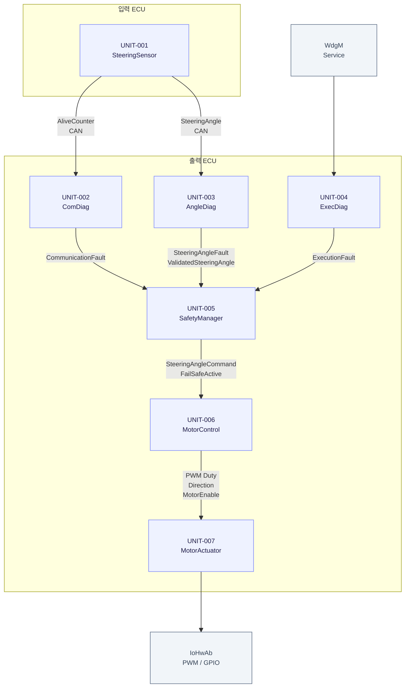
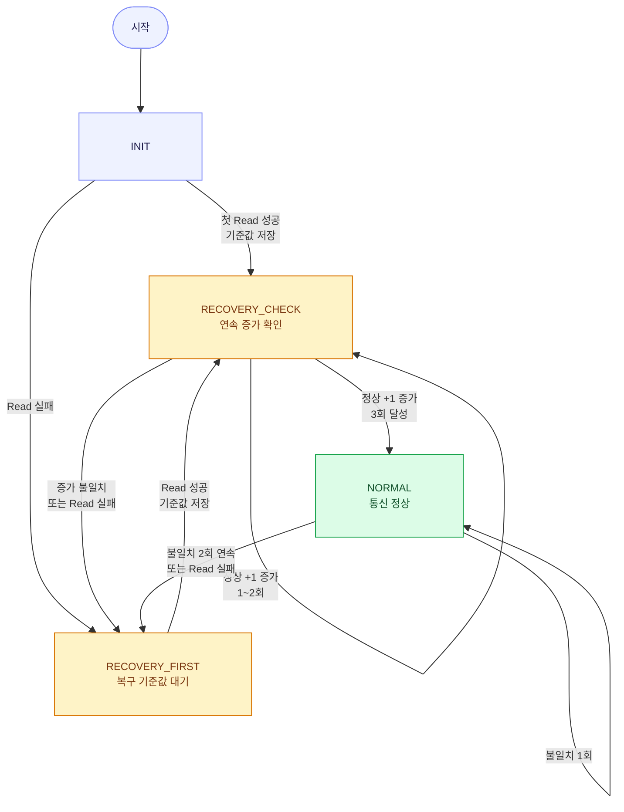
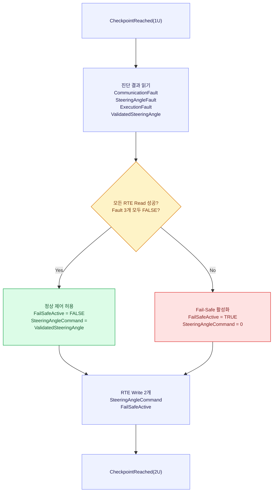

# 소프트웨어 상세설계 및 단위 구현 명세서

**Document ID**: STEER-05-SWDDUC  
**ISO 26262 Reference**: Part 6, Clause 8  
**ASPICE Reference**: SWE.3 (Software Detailed Design and Unit Construction)  
**Version**: 1.6 (개정안 — Mermaid 레이아웃 개선)  
**Date**: 2026-10-24  
**Status**: Draft — `src/` 현행 구현 기준  
**Project Title**: AUTOSAR 기반 조향 관련 오류에 대한 복구 및 진단 시스템  
**Related Document**: `04_SW_Architecture_Design.md`

---

## 1. 문서 목적 및 범위

본 문서는 `04_SW_Architecture_Design.md`의 **7개 SWC 아키텍처**를 기준으로, 각 소프트웨어 단위의 입출력, 내부 상태, 분기 조건, 계산식, RTE 및 BSW 호출을 실제 `src/` C 코드에 맞추어 기술한다. 단위시험 조건과 결과는 `06_SW_Unit_Verification.md`에서 관리한다.

**문서화 원칙:** 아래의 **현재 구현**은 GitHub `main` 브랜치의 소스에서 확인한 동작이다. 요구사항과 다른 동작이나 미확인 설정은 구현된 것처럼 기술하지 않고 13장에 별도로 기재한다.

## 2. 상세설계 기준

| 항목 | 기준 |
|---|---|
| 언어 및 플랫폼 | C / AUTOSAR Classic / Mobilgene Classic |
| 대상 MCU | MPC-5606B |
| 입력 ECU | ADC 입력, 조향각 변환, Alive Counter 생성 |
| 출력 ECU | 통신·조향각·실행 진단, 안전 명령, 모터 제어 및 출력 |
| SWC 통신 | Sender-Receiver RTE Read/Write |
| BSW/HW 서비스 | WdgM 및 IoHwAb Client-Server 호출 |
| 안전 출력 | Fault 시 조향 명령 0, PWM 0, 방향 출력 비활성 |
| 복구 처리 | ComDiag의 Alive Counter 연속 3회 확인; SafetyManager는 Fault 통합만 수행 |
| Event/Task | 소스만으로 확정 불가. ARXML/ECU Configuration 대조 필요 |

## 3. 소프트웨어 단위 구성 및 데이터 흐름

| Unit ID | SWC ID | SWC | Runnable | 소스 파일 |
|---|---|---|---|---|
| UNIT-001 | SWC-001 | SWC_SteeringSensor | `RE_Can_Tx_10ms()` | `src/SWC_SteerSensor.c` |
| UNIT-002 | SWC-002 | SWC_ComDiag | `ComDiag_func()` | `src/SWC_ComDiag.c` |
| UNIT-003 | SWC-003 | SWC_AngleDiag | `AngleDiag_func()` | `src/SWC_AngleDiag.c` |
| UNIT-004 | SWC-004 | SWC_ExecDiag | `ExecDiag_func()` | `src/SWC_ExecDiag.c` |
| UNIT-005 | SWC-005 | SWC_SafetyManager | `SafetyManager_func()` | `src/SWC_SafetyManager.c` |
| UNIT-006 | SWC-006 | SWC_MotorControl | `MotorControl_func()` | `src/SWC_MotorControl.c` |
| UNIT-007 | SWC-007 | SWC_MotorActuator | `MotorActuator_func()` | `src/SWC_MotorActuator.c` |



> 두 ECU 사이의 화살표는 **논리적 데이터 흐름**을 나타낸다. 실제 CAN Mapping, COM/PduR 및 ECU Extract 설정은 별도로 확인해야 한다.

---

## 4. UNIT-001 — Steering Sensor

### 4.1 인터페이스 및 내부 변수

| 구분 | 이름 | 자료형 / 내용 |
|---|---|---|
| Client-Server R-Port | `R_Potentiometer` | `ReadDirect(&level, 1U)` |
| Sender-Receiver P-Port | `P_SteeringSensorData` | `AliveCounter:uint8`, `SteeringAngle:sint16` |
| Static 변수 | `aliveCounter` | `uint8`, 초기값 `0U` |
| Local 변수 | `level` | `IoHwAb_ValueType` |
| Local 변수 | `angle` | `sint16` |
| Runnable | `RE_Can_Tx_10ms()` | 입력 ECU, 10 ms 실행 의도 |

### 4.2 처리 로직

1. `Rte_Call_R_Potentiometer_ReadDirect(&level, 1U)` 호출.
2. `angle = (sint16)(level - 512)` 계산.
3. `Rte_Write_P_SteeringSensorData_AliveCounter(aliveCounter++)` 호출. **현재 값을 송신한 후 증가**한다.
4. `Rte_Write_P_SteeringSensorData_SteeringAngle(angle)` 호출.
5. `uint8` 증가에 따라 255 다음은 0으로 순환한다.

### 4.3 상세설계 규칙

| ID | 현재 구현 | 추적 |
|---|---|---|
| SWD-IN-001 | IoHwAb `ReadDirect`로 ADC 값 취득 | SWR-IN-001 |
| SWD-IN-002 | ADC 값에서 512를 빼 조향각 생성 | SWR-IN-001 |
| SWD-COM-001 | Alive Counter 및 조향각을 RTE Write로 제공 | SWR-COM-001 |
| SWD-COM-002 | Alive Counter를 `uint8`로 1 증가 | SWR-COM-001 |

**확인 필요:** ADC 호출 반환값을 `(void)` 처리하고 `level`을 초기화하지 않는다. Read 실패 시 미초기화 값 사용 위험이 있으므로 오류 처리 개선이 필요하다. RTE Write 결과도 확인하지 않는다.

---

## 5. UNIT-002 — Communication Diagnostic

### 5.1 인터페이스 및 상수

| 구분 | 이름 | 내용 |
|---|---|---|
| R-Port | `R_SteeringSensorData` | `AliveCounter:uint8` |
| P-Port | `P_CommunicationDiagnostic` | `CommunicationFault:boolean` |
| 상수 | `SEQUENCE_ERROR_LIMIT` | `2U` |
| 상수 | `RECOVERY_VALID_LIMIT` | `3U` |
| Runnable | `ComDiag_func()` | Alive Counter 진단 |

### 5.2 내부 상태

| 변수 | 자료형 | 초기값 | 역할 |
|---|---|---|---|
| `aliveState` | `AliveDiagState` | `ALIVE_STATE_INIT` | 진단 상태 |
| `prevAliveCounter` | `uint8` | `0U` | 비교 기준값 |
| `sequenceErrorCnt` | `uint8` | `0U` | 연속 시퀀스 오류 수 |
| `recoveryCount` | `uint8` | `0U` | 연속 정상 증가 수 |
| `communicationFault` | `boolean` | Runnable마다 `TRUE` | 기본 Fault 출력 |

상태 열거형: `ALIVE_STATE_INIT`, `ALIVE_STATE_NORMAL`, `ALIVE_STATE_RECOVERY_FIRST`, `ALIVE_STATE_RECOVERY_CHECK`.

### 5.3 상태 전이 및 판정



**현재 구현의 정확한 동작:**

1. RTE Read 실패 시 상태를 `RECOVERY_FIRST`로, 두 Counter를 0으로 초기화한다.
2. `INIT`에서는 최초 읽은 Counter를 기준값으로 저장하고 `RECOVERY_CHECK`로 이동한다. **최초 정상 수신 직후에도 CommunicationFault는 TRUE**이다.
3. `NORMAL`에서는 `expectedAliveCounter = (uint8)(prevAliveCounter + 1U)`로 기대값을 계산한다.
4. 정상 증가 시 `sequenceErrorCnt=0`, `prevAliveCounter=현재값`으로 갱신한다.
5. 첫 불일치 시 `sequenceErrorCnt=1`로 설정하고 **불일치 값을 다음 비교의 기준값으로 갱신**한다.
6. 다음 실행에서도 기대값과 불일치하면 `RECOVERY_FIRST`로 이동한다. 이때 해당 Fault 입력값을 복구 기준값으로 사용하지 않는다.
7. `RECOVERY_FIRST`의 첫 성공값을 새 기준으로 저장하고 `RECOVERY_CHECK`로 이동한다.
8. 이후 기대값 +1 증가를 3회 연속 확인해야 `NORMAL`로 복귀한다. 불일치 시 다시 `RECOVERY_FIRST`로 이동한다.
9. RTE Read 성공 및 `aliveState == ALIVE_STATE_NORMAL`인 경우에만 `CommunicationFault=FALSE`를 출력한다.

### 5.4 상세설계 규칙

| ID | 현재 구현 | 추적 |
|---|---|---|
| SWD-COMDIAG-001 | RTE Read 실패 시 통신 Fault 유지 및 복구 상태 초기화 | SWR-COM-002, SWR-DIAG-004 |
| SWD-COMDIAG-002 | `uint8` 기대값 +1 비교 및 255→0 처리 | SWR-DIAG-001, 002 |
| SWD-COMDIAG-003 | NORMAL에서 연속 시퀀스 불일치 2회 시 Fault | SWR-DIAG-003 — **정합성 검토** |
| SWD-COMDIAG-004 | Fault 후 첫 성공값을 복구 기준으로 저장 | SWR-REC-001, 003 |
| SWD-COMDIAG-005 | 기준값 이후 +1 증가 3회 연속 시 통신 Fault 해제 | SWR-REC-002 — **적용 범위 검토** |
| SWD-COMDIAG-006 | `CommunicationFault` RTE Write | SWR-DIAG-004 |

**미구현/미확인:** COM Timeout 및 메시지 freshness 진단은 이 C 코드에서 확인되지 않는다. `Rte_Read == E_OK`만으로 신규 CAN 프레임 도착을 증명할 수 없다.

---

## 6. UNIT-003 — Steering Angle Diagnostic

### 6.1 인터페이스 및 상수

| 구분 | 이름 | 내용 |
|---|---|---|
| R-Port | `R_SteeringSensorData` | `SteeringAngle:sint16` |
| P-Port | `P_SteeringAngleDiagnostic` | `SteeringAngleFault:boolean`, `ValidatedSteeringAngle:sint16` |
| `STEERING_ANGLE_MIN` | 상수 | `-512` |
| `STEERING_ANGLE_MAX` | 상수 | `511` |
| Runnable | `AngleDiag_func()` | 조향각 유효성 검사 |

### 6.2 처리 절차

1. `steeringAngle=0`, `validatedSteeringAngle=0`, `steeringAngleFault=TRUE`로 초기화한다.
2. `Rte_Read_R_SteeringSensorData_SteeringAngle(&steeringAngle)`를 호출한다.
3. Read 성공 및 `-512 <= steeringAngle <= 511`이면 Fault를 FALSE로 변경하고 입력 조향각을 검증값으로 전달한다.
4. Read 실패 또는 범위 초과 시 기본값인 Fault TRUE, 검증값 0을 유지한다.
5. 두 출력값을 각각 RTE Write한다.

| ID | 현재 구현 | 추적 |
|---|---|---|
| SWD-ANGLE-001 | RTE Read 및 범위 `[-512,511]` 검사 | SWR-DIAG-005 ~ 007 |
| SWD-ANGLE-002 | 비정상 시 Fault TRUE, 검증 조향각 0 | SWR-DIAG-008 |
| SWD-ANGLE-003 | 정상 시 Fault FALSE, 입력 조향각 전달 | SWR-DIAG-008 |

---

## 7. UNIT-004 — SW Execution Diagnostic

### 7.1 인터페이스 및 내부 함수

| 구분 | 이름 | 내용 |
|---|---|---|
| Client-Server R-Port | `R_WdgMService` | `GetGlobalStatus()`, `GetFirstExpiredSEID()` |
| P-Port | `P_ExecutionDiagnostic` | `ExecutionFault:boolean` |
| Static 함수 | `App_IsWdgmFault(status)` | WdgM 상태의 Fault 여부 판정 |
| Runnable | `ExecDiag_func()` | 실행 상태 진단 |

### 7.2 WdgM 판정표

| 조건 | `executionFault` |
|---|---|
| `GetGlobalStatus()` 반환값이 `E_OK`이고 상태가 `FAILED` | TRUE |
| `E_OK`이고 `EXPIRED` | TRUE |
| `E_OK`이고 `STOPPED` | TRUE |
| `E_OK`이고 `OK` | FALSE |
| `E_OK`이고 위 Fault 상태가 아닌 값 | FALSE (현재 함수 구현) |
| `GetGlobalStatus()` 실패 | TRUE (초기값 유지) |

`EXPIRED` 상태에서는 `GetFirstExpiredSEID(&expiredSeId)`를 추가 호출한다. 현재 코드는 반환값과 식별값을 이후 로직에 사용하지 않는다.

| ID | 현재 구현 | 추적 |
|---|---|---|
| SWD-EXEC-001 | WdgM Global Status 조회 및 실패 시 Fault | SWR-EXEC-001 ~ 003 |
| SWD-EXEC-002 | FAILED, EXPIRED, STOPPED를 Fault로 분류 | SWR-EXEC-002 |
| SWD-EXEC-003 | EXPIRED 시 최초 만료 SE ID 조회 | SWR-EXEC-002 |
| SWD-EXEC-004 | `ExecutionFault` RTE Write | SWR-EXEC-003 |

**확인 필요:** 실제 WdgM Supervised Entity, Deadline/Alive/Logical Supervision, 상태 변화 및 ECU 수준 안전 반응은 설정 파일로 검증해야 한다.

---

## 8. UNIT-005 — Safety Manager

### 8.1 인터페이스

| 구분 | Port | 데이터 / Operation |
|---|---|---|
| R-Port | `R_CommunicationDiagnostic` | `CommunicationFault` |
| R-Port | `R_SteeringAngleDiagnostic` | `SteeringAngleFault`, `ValidatedSteeringAngle` |
| R-Port | `R_ExecutionDiagnostic` | `ExecutionFault` |
| P-Port | `P_SafeSteeringCommand` | `SteeringAngleCommand`, `FailSafeActive` |
| Client-Server R-Port | `R_SafetyWdgMCheckpoint` | `CheckpointReached(1U)`, `CheckpointReached(2U)` |
| Runnable | — | `SafetyManager_func()` |

### 8.2 안전 판단 로직



**중요:** 현재 `SafetyManager_func()`에는 `gIsFailsafe`, `gNormalRecoverCnt` 또는 3회 복구 Counter가 **없다**. 매 실행마다 현재 진단 결과를 읽고 즉시 안전 명령을 결정한다. 통신 복구 지연은 ComDiag의 `CommunicationFault`에 반영된다.

| ID | 현재 구현 | 추적 |
|---|---|---|
| SWD-SAFE-001 | 진입 시 Checkpoint ID 1 보고 | SWR-EXEC-001 |
| SWD-SAFE-002 | 3개 Fault 및 검증 조향각 RTE Read | SWR-SAFE-001 |
| SWD-SAFE-003 | 모든 Read 성공, 모든 Fault FALSE일 때 정상 명령 출력 | SWR-SAFE-001, SWR-REC-004 |
| SWD-SAFE-004 | Fault 또는 Read 오류 시 조향 명령 0, FailSafeActive TRUE | SWR-SAFE-002 ~ 005 |
| SWD-SAFE-005 | 종료 시 Checkpoint ID 2 보고 | SWR-EXEC-001 |

**확인 필요:** `CheckpointReached()`와 출력 RTE Write 반환값은 현재 확인하지 않는다. Checkpoint ID가 실제 WdgM 설정과 일치하는지 검증해야 한다.

---

## 9. UNIT-006 — Motor Control

### 9.1 인터페이스, 상수 및 내부 상태

| 구분 | 이름 | 값 / 역할 |
|---|---|---|
| R-Port | `R_SafeSteeringCommand` | `SteeringAngleCommand`, `FailSafeActive` |
| P-Port | `P_MotorDriveCommand` | `PwmDutyCycle`, `MotorDirectionLeft`, `MotorDirectionRight`, `MotorEnable` |
| `PWM_SCALE_MAX` | 상수 | `32768U` |
| `PWM_DUTY_MAX` | 상수 | `16384U` |
| `STEER_DIFF_MAX` | 상수 | `512` |
| `STEER_DIFF_THRESHOLD` | 상수 | `2` |
| `prevSteeringAngle` | `static sint16` | 초기값 0, 이전 명령 각도 |
| `referenceInitialized` | `static boolean` | 초기값 FALSE, 기준 각도 설정 여부 |
| Runnable | — | `MotorControl_func()` |

### 9.2 처리 절차

1. 조향 명령과 FailSafeActive를 각각 RTE Read한다. 출력값은 매 실행 시 PWM 0, 방향 FALSE/FALSE, Enable FALSE로 초기화한다.
2. **Read 실패 또는 FailSafeActive TRUE:** `referenceInitialized=FALSE`로 설정하고 비활성 출력 유지.
3. **첫 정상 실행:** `prevSteeringAngle=steeringAngleCommand`, `referenceInitialized=TRUE`로 설정하고 비활성 출력 유지.
4. **이후 정상 실행:** `steeringDiff = (sint32)steeringAngleCommand - (sint32)prevSteeringAngle` 계산.
5. `steeringDiff > 2`이면 Right=TRUE, Left=FALSE, Enable=TRUE.
6. `steeringDiff < -2`이면 Left=TRUE, Right=FALSE, Enable=TRUE.
7. `-2 <= steeringDiff <= 2`이면 방향 FALSE/FALSE, Enable=FALSE, PWM 0.
8. Enable TRUE일 때 절대 변화량 `absDiff`를 512 이하로 제한한 뒤 아래 식으로 PWM 계산.
9. 처리 후 `prevSteeringAngle`을 현재 조향 명령으로 갱신하고 4개 출력값을 RTE Write한다.

### 9.3 PWM 계산식

```text
absDiff = min(abs(steeringDiff), 512)
relativeDutyCycle = (uint32)(absDiff * 32768) / 512
pwmDutyCycle = (uint16)((16384 * relativeDutyCycle) >> 15)
```

현재 식에서는 `absDiff=512`일 때 `pwmDutyCycle=16384`가 된다. 이는 `32768` 스케일 기준 50%에 해당한다. 실제 물리 PWM의 비율은 MCAL 채널 설정과 함께 확인해야 한다.

### 9.4 상세설계 규칙

| ID | 현재 구현 | 추적 |
|---|---|---|
| SWD-CTRL-001 | Fault/Read 실패 시 출력 차단 및 기준 초기화 | SWR-SAFE-002 ~ 004 |
| SWD-CTRL-002 | 첫 정상 입력은 기준값으로만 사용 | SWR-REC-004 |
| SWD-CTRL-003 | 조향 명령 변화량 계산 | SWR-CTRL-001 |
| SWD-CTRL-004 | 변화량이 ±2를 초과할 때만 방향 활성화 | SWR-CTRL-001, 002 |
| SWD-CTRL-005 | 절대 변화량을 512로 제한하고 PWM 계산 | SWR-CTRL-001 |
| SWD-CTRL-006 | 4개 모터 명령 RTE Write | SWR-ACT-001 |

**설계 경계:** 현재 제어는 실제 모터 위치 피드백이 아니라 **연속된 조향 명령값의 변화량**에 기반한다. 폐루프 위치제어로 표현하지 않는다.

---

## 10. UNIT-007 — Motor Actuator

### 10.1 인터페이스

| 구분 | Port | 데이터 / Operation |
|---|---|---|
| R-Port | `R_MotorDriveCommand` | `PwmDutyCycle`, `MotorDirectionLeft`, `MotorDirectionRight`, `MotorEnable` |
| Client-Server R-Port | `R_PwmMotor` | `SetDutyCycle(uint16)` |
| Client-Server R-Port | `R_MotorIn1` | `WriteDirect(boolean)` |
| Client-Server R-Port | `R_MotorIn2` | `WriteDirect(boolean)` |
| Client-Server R-Port | `R_StopLed` | `WriteDirect(boolean)` |
| 상수 | `PWM_DUTY_MAX` | `16384U` |
| Runnable | — | `MotorActuator_func()` |

### 10.2 출력 결정표

| 조건 | MotorEnable 최종값 | PWM 출력 | MotorIn1 / MotorIn2 | StopLed |
|---|---|---|---|---|
| 4개 RTE Read 중 하나라도 실패 | FALSE | 0 | FALSE / FALSE | TRUE |
| PWM Duty > 16384 | FALSE | 0 | FALSE / FALSE | TRUE |
| Left == Right | FALSE | 0 | FALSE / FALSE | TRUE |
| 입력 MotorEnable == FALSE | FALSE | 0 | FALSE / FALSE | TRUE |
| 위 오류 없음, MotorEnable == TRUE | TRUE | 전달된 PWM | 전달된 Left / Right | FALSE |

`Left == Right`는 양쪽이 모두 FALSE인 경우도 포함한다. 따라서 MotorEnable TRUE 상태에서 방향 두 신호가 같으면 안전 출력을 적용한다.

### 10.3 실제 출력 순서

- **비활성:** `R_PwmMotor_SetDutyCycle(0U)` → `R_MotorIn1_WriteDirect(FALSE)` → `R_MotorIn2_WriteDirect(FALSE)` → `R_StopLed_WriteDirect(TRUE)`.
- **활성:** MotorIn1 → MotorIn2 → PWM Duty → StopLed FALSE 순서로 호출한다.

### 10.4 상세설계 규칙

| ID | 현재 구현 | 추적 |
|---|---|---|
| SWD-ACT-001 | 4개 모터 명령 RTE Read | SWR-ACT-001 |
| SWD-ACT-002 | Read 실패, Duty 초과, 방향 충돌 시 출력 차단 | SWR-ACT-002 |
| SWD-ACT-003 | 비활성 시 PWM 0, 방향 FALSE/FALSE, StopLed TRUE | SWR-SAFE-003, 004 |
| SWD-ACT-004 | 정상 활성 시 방향·PWM·LED 서비스 호출 | SWR-ACT-001 |

**확인 필요:** 현재 IoHwAb 호출 반환값은 `(void)`로 처리한다. 하드웨어 출력 실패 시 별도의 Fault 전달이나 재시도는 이 코드에 구현되어 있지 않다. 핀·PWM 채널 할당은 ECU Configuration과 대조한다.

---

## 11. RTE 및 BSW 호출 추적성

| Integration ID | 실제 호출 패턴 | 사용 Unit |
|---|---|---|
| INT-001 | `Rte_Call_R_Potentiometer_ReadDirect` | UNIT-001 |
| INT-002 | `Rte_Write_P_SteeringSensorData_*` | UNIT-001 |
| INT-003 | `Rte_Read_R_SteeringSensorData_AliveCounter` | UNIT-002 |
| INT-004 | `Rte_Write_P_CommunicationDiagnostic_CommunicationFault` | UNIT-002 |
| INT-005 | `Rte_Read_R_SteeringSensorData_SteeringAngle` | UNIT-003 |
| INT-006 | `Rte_Write_P_SteeringAngleDiagnostic_*` | UNIT-003 |
| INT-007 | `Rte_Call_R_WdgMService_GetGlobalStatus` | UNIT-004 |
| INT-008 | `Rte_Call_R_WdgMService_GetFirstExpiredSEID` | UNIT-004 |
| INT-009 | `Rte_Write_P_ExecutionDiagnostic_ExecutionFault` | UNIT-004 |
| INT-010 | `Rte_Call_R_SafetyWdgMCheckpoint_CheckpointReached` | UNIT-005 |
| INT-011 | `Rte_Read_R_CommunicationDiagnostic_CommunicationFault` | UNIT-005 |
| INT-012 | `Rte_Read_R_SteeringAngleDiagnostic_*` | UNIT-005 |
| INT-013 | `Rte_Read_R_ExecutionDiagnostic_ExecutionFault` | UNIT-005 |
| INT-014 | `Rte_Write_P_SafeSteeringCommand_*` | UNIT-005 |
| INT-015 | `Rte_Read_R_SafeSteeringCommand_*` | UNIT-006 |
| INT-016 | `Rte_Write_P_MotorDriveCommand_*` | UNIT-006 |
| INT-017 | `Rte_Read_R_MotorDriveCommand_*` | UNIT-007 |
| INT-018 | `Rte_Call_R_PwmMotor_SetDutyCycle` | UNIT-007 |
| INT-019 | `Rte_Call_R_MotorIn1_WriteDirect`, `Rte_Call_R_MotorIn2_WriteDirect` | UNIT-007 |
| INT-020 | `Rte_Call_R_StopLed_WriteDirect` | UNIT-007 |

## 12. 실행 흐름 및 SW 요구사항 추적성

### 12.1 논리적 실행 흐름

1. UNIT-001이 조향각과 Alive Counter를 RTE에 기록한다.
2. CAN을 통해 출력 ECU로 데이터가 전달된다(구체적인 Mapping은 설정 확인 대상).
3. UNIT-002는 Alive Counter를, UNIT-003은 조향각을 각각 진단한다.
4. UNIT-004는 WdgM 상태를 확인해 실행 Fault를 제공한다.
5. UNIT-005는 세 Fault와 검증 조향각을 통합하여 FailSafeActive 및 안전 조향 명령을 제공한다.
6. UNIT-006은 안전 명령에 따라 PWM/방향/Enable을 계산한다.
7. UNIT-007은 명령을 검증하고 IoHwAb로 실제 출력을 수행한다.

**주의:** 위 순서는 **논리적 데이터 의존 관계**다. Runnable 실제 실행 순서, Event, Task Mapping, 데이터 갱신 보장은 소스 파일만으로 확정할 수 없다.

### 12.2 요구사항별 할당

| SW 요구사항 | 상세설계 Unit / ID | 비고 |
|---|---|---|
| SWR-IN-001 | UNIT-001 / SWD-IN-001, 002 | ADC 실패 처리 검토 |
| SWR-COM-001 | UNIT-001 / SWD-COM-001, 002 | 10 ms Event 설정 확인 |
| SWR-COM-002 | UNIT-002, 003 | CAN 수신 Mapping 확인 |
| SWR-DIAG-001 ~ 004 | UNIT-002 / SWD-COMDIAG-001 ~ 006 | 동일값 2회 vs 시퀀스 불일치 2회 차이 검토 |
| SWR-DIAG-005 ~ 008 | UNIT-003 / SWD-ANGLE-001 ~ 003 | 범위 및 Read 검사 |
| SWR-EXEC-001 ~ 003 | UNIT-004, 005 / SWD-EXEC-001 ~ 004, SWD-SAFE-001, 005 | WdgM 설정 확인 |
| SWR-SAFE-001 ~ 005 | UNIT-005 ~ 007 / SWD-SAFE-002 ~ 004, SWD-CTRL-001, SWD-ACT-002, 003 | 출력 차단 |
| SWR-REC-001 ~ 003 | UNIT-002 / SWD-COMDIAG-004, 005 | **시스템 전체 복귀 요건과 차이** |
| SWR-REC-004 | UNIT-005, 006 / SWD-SAFE-003, SWD-CTRL-002 | 첫 정상 입력 기준값 처리 |
| SWR-CTRL-001, 002 | UNIT-006 / SWD-CTRL-003 ~ 005 | PWM 및 방향 |
| SWR-ACT-001, 002 | UNIT-007 / SWD-ACT-001 ~ 004 | IoHwAb 출력 |

---

## 13. 요구사항·코드 정합성 및 미확인 사항

| ID | 구분 | 확인 내용 | 후속 조치 |
|---|---|---|---|
| GAP-001 | 요구사항 불일치 | `SWR-DIAG-003`은 동일 Alive Counter 2회 연속을 기준으로 기술하지만, 현재 ComDiag는 **기대값 +1 시퀀스 불일치 2회**를 기준으로 판단 | 요구사항 또는 코드 기준 일치화 |
| GAP-002 | 요구사항 불일치 | `SWR-REC-002`는 시스템 전체 정상 조건 연속 3회를 요구하지만, 현재 3회 확인은 ComDiag 통신 Fault 복구에만 적용 | 시스템 공통 복구 정책 확정 후 요구사항/코드 정합화 |
| GAP-003 | CAN Timeout | ComDiag 소스에는 수신 Timeout 및 신규 프레임 여부 판단 로직이 없음 | COM Timeout 설정·통합 검증 |
| GAP-004 | ADC 오류 | SteeringSensor가 ADC Read 결과를 확인하지 않고 `level`을 초기화하지 않음 | 실패 시 안전 기본값 및 Fault 전달 설계 |
| GAP-005 | RTE/IoHwAb 오류 | 다수 RTE Write, Checkpoint, IoHwAb 출력 호출의 반환값을 무시 | 안전 요구사항에 따른 오류 대응 검토 |
| GAP-006 | 실행 스케줄 | 실제 Data Received Event, Timing Event, Task Mapping 미확인 | ARXML 및 ECU Configuration 대조 |
| GAP-007 | WdgM 설정 | Checkpoint ID 1/2, Supervised Entity 및 실행 이상 반응 설정 미확인 | WdgM 설정·실행 검증 |
| GAP-008 | 출력 HW | PWM 채널, GPIO 핀, 모터 방향의 물리 연결은 C 코드만으로 확정 불가 | IoHwAb/MCAL 설정과 회로 검증 |
| GAP-009 | 제어 구조 | MotorControl은 조향 명령 변화량에 기반하며 실제 모터 위치 피드백은 없음 | 기능 정의에 따라 개루프 제어 범위 명시 |
| GAP-010 | 복구 초기화 | ComDiag는 최초 정상 Read 직후 바로 NORMAL이 아니라 3회 증가를 확인해야 NORMAL | 초기 기동 요구사항 및 테스트 기대값 정합화 |

## 14. 후속 검증 및 문서 갱신

- `04_SW_Architecture_Design.md`: 7개 SWC 및 Interface/Port 연결과 본 문서의 Unit ID 일치 여부 확인.
- `03_SW_Requirements.md`: GAP-001, GAP-002 요구사항 정합성 검토.
- `06_SW_Unit_Verification.md`: 7개 Unit의 정상·경계·오류 및 상태 전이 테스트 케이스 갱신.
- `07_SW_Integration_Verification.md`: Fault 통합, 데이터 전달, RTE 오류, 안전 출력 및 CAN Timeout 검증.
- `08_System_Verification.md`: 실제 모터 차단, CAN 중단, WdgM 오류, 정상 복구 검증.
- `Traceability_Matrix.md`: SWR ↔ SWC ↔ UNIT ↔ SWD ↔ 테스트 케이스 연결 갱신.

---

**문서 상태:** 본 개정안은 `src/` C 코드에 맞춘 상세설계 초안이다. ARXML/MCAL 설정과 검증 결과가 확인되지 않은 항목은 구현 완료로 판정하지 않는다.
