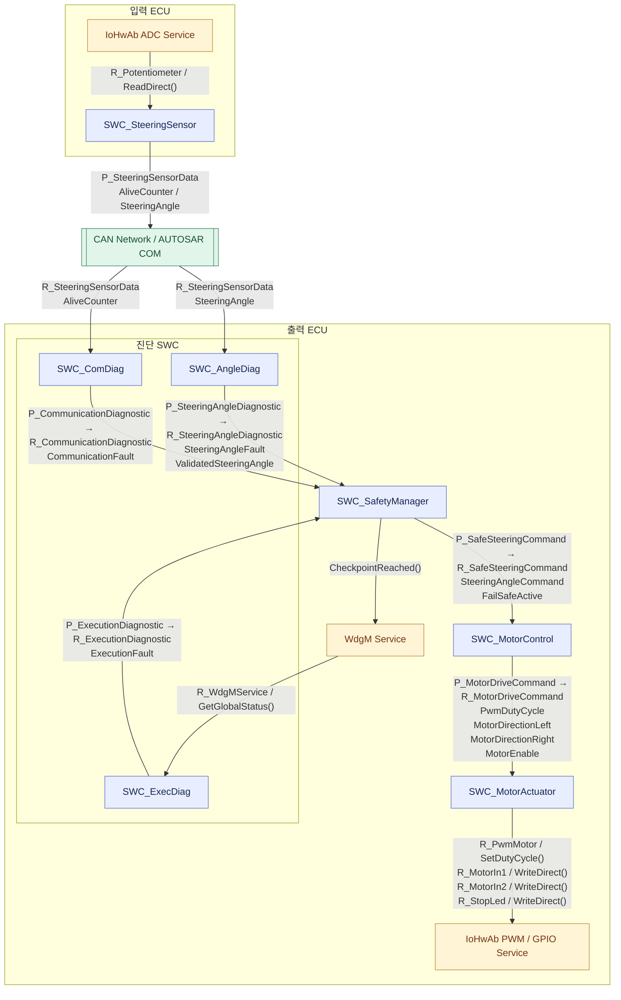

### 3.3 AUTOSAR SWC Composition 및 Port 연결 구조

본 시스템은 AUTOSAR Classic의 Sender-Receiver 및 Client-Server 통신 방식을 사용한다.

각 SWC는 P-Port(Provided Port)와 R-Port(Required Port)를 통해 데이터를 제공하거나 수신한다. SWC 사이의 데이터 연결은 Assembly Connector를 통해 구성하며, 하드웨어 및 BSW 서비스는 Client-Server Interface를 통해 사용한다.

#### 3.3.1 SWC Composition Diagram

※ 위 다이어그램은 AUTOSAR SWC Composition의 논리적 연결을 Mermaid Flowchart로 표현한 것이다. 실제 AUTOSAR ARXML에서는 각 Port Prototype과 Interface, Assembly Connector를 별도로 정의한다.

#### 3.3.2 Sender-Receiver Port 및 Interface 정의

| 제공 SWC | P-Port | Interface | Data Element | 수신 SWC | R-Port |
|---|---|---|---|---|---|
| SteeringSensor | P_SteeringSensorData | If_SteeringSensorData | AliveCounter | ComDiag | R_SteeringSensorData |
| SteeringSensor | P_SteeringSensorData | If_SteeringSensorData | SteeringAngle | AngleDiag | R_SteeringSensorData |
| ComDiag | P_CommunicationDiagnostic | If_CommunicationDiagnostic | CommunicationFault | SafetyManager | R_CommunicationDiagnostic |
| AngleDiag | P_SteeringAngleDiagnostic | If_SteeringAngleDiagnostic | SteeringAngleFault | SafetyManager | R_SteeringAngleDiagnostic |
| AngleDiag | P_SteeringAngleDiagnostic | If_SteeringAngleDiagnostic | ValidatedSteeringAngle | SafetyManager | R_SteeringAngleDiagnostic |
| ExecDiag | P_ExecutionDiagnostic | If_ExecutionDiagnostic | ExecutionFault | SafetyManager | R_ExecutionDiagnostic |
| SafetyManager | P_SafeSteeringCommand | If_SafeSteeringCommand | SteeringAngleCommand | MotorControl | R_SafeSteeringCommand |
| SafetyManager | P_SafeSteeringCommand | If_SafeSteeringCommand | FailSafeActive | MotorControl | R_SafeSteeringCommand |
| MotorControl | P_MotorDriveCommand | If_MotorDriveCommand | PwmDutyCycle | MotorActuator | R_MotorDriveCommand |
| MotorControl | P_MotorDriveCommand | If_MotorDriveCommand | MotorDirectionLeft | MotorActuator | R_MotorDriveCommand |
| MotorControl | P_MotorDriveCommand | If_MotorDriveCommand | MotorDirectionRight | MotorActuator | R_MotorDriveCommand |
| MotorControl | P_MotorDriveCommand | If_MotorDriveCommand | MotorEnable | MotorActuator | R_MotorDriveCommand |

#### 3.3.3 Client-Server Port 및 서비스 정의

| SWC | R-Port | Operation | 목적 |
|---|---|---|---|
| SteeringSensor | R_Potentiometer | ReadDirect() | ADC 입력값 읽기 |
| ExecDiag | R_WdgMService | GetGlobalStatus() | WdgM 실행 상태 조회 |
| ExecDiag | R_WdgMService | GetFirstExpiredSEID() | 실행 이상 발생 SWC 식별 |
| SafetyManager | WdgM Checkpoint 서비스 Port | CheckpointReached() | 실행 Checkpoint 보고 |
| MotorActuator | R_PwmMotor | SetDutyCycle() | PWM Duty 설정 |
| MotorActuator | R_MotorIn1 | WriteDirect() | 모터 방향 신호 1 출력 |
| MotorActuator | R_MotorIn2 | WriteDirect() | 모터 방향 신호 2 출력 |
| MotorActuator | R_StopLed | WriteDirect() | Fail-Safe 표시 LED 출력 |

※ WdgM Checkpoint 서비스 Port의 정확한 이름은 생성된 RTE 및 ARXML과 대조하여 확정한다.

#### 3.3.4 Assembly Connector 설계

| Connector ID | 제공 SWC | P-Port | 수신 SWC | R-Port |
|---|---|---|---|---|
| AC-001 | SteeringSensor | P_SteeringSensorData | ComDiag | R_SteeringSensorData |
| AC-002 | SteeringSensor | P_SteeringSensorData | AngleDiag | R_SteeringSensorData |
| AC-003 | ComDiag | P_CommunicationDiagnostic | SafetyManager | R_CommunicationDiagnostic |
| AC-004 | AngleDiag | P_SteeringAngleDiagnostic | SafetyManager | R_SteeringAngleDiagnostic |
| AC-005 | ExecDiag | P_ExecutionDiagnostic | SafetyManager | R_ExecutionDiagnostic |
| AC-006 | SafetyManager | P_SafeSteeringCommand | MotorControl | R_SafeSteeringCommand |
| AC-007 | MotorControl | P_MotorDriveCommand | MotorActuator | R_MotorDriveCommand |

※ AC-001 및 AC-002는 서로 다른 ECU에 배치된 SWC의 논리적 데이터 연결이다. 실제 ECU 간 통신은 CAN 신호 매핑과 AUTOSAR COM 설정을 통해 구현하며, 단일 ECU Composition 내부의 Assembly Connector와 구분하여 관리한다.

#### 3.3.5 아키텍처 설계 특징

**1. 진단 기능의 독립성**

통신 이상, 조향각 유효성 오류, SW 실행 이상을 각각 독립 SWC에서 진단한다.

이를 통해 개별 진단 로직의 변경이 다른 SWC에 미치는 영향을 줄이고, 기능별 검증과 유지보수를 용이하게 한다.

**2. 안전 판단과 모터 제어의 분리**

SafetyManager는 진단 결과를 통합하여 FailSafeActive와 SteeringAngleCommand를 생성한다.

MotorControl은 안전 판단 로직을 직접 수행하지 않고, 전달받은 안전 명령을 기반으로 PWM 및 방향 신호를 계산한다.

**3. 하드웨어 의존성 분리**

MotorActuator는 IoHwAb 서비스로 PWM과 GPIO를 제어한다.

상위 SWC는 하드웨어 핀과 레지스터에 직접 접근하지 않으므로, 하드웨어 구성이 변경되더라도 상위 제어 로직의 변경 범위를 줄일 수 있다.

**4. AUTOSAR Interface 기반 재사용성**

각 SWC는 정의된 Port와 Interface를 통해 상호작용한다.

Interface 계약이 유지되는 범위에서 SWC의 내부 구현을 변경하거나 다른 ECU 구성에 재사용할 수 있다.

**5. Fail-Safe 출력 경로**

SafetyManager는 Fault 발생 시 SteeringAngleCommand를 0으로 설정하고 FailSafeActive를 TRUE로 출력한다.

MotorControl은 FailSafeActive를 확인하여 모터 출력을 비활성화하며, MotorActuator는 PWM 0 및 방향 신호 비활성화를 수행한다.
